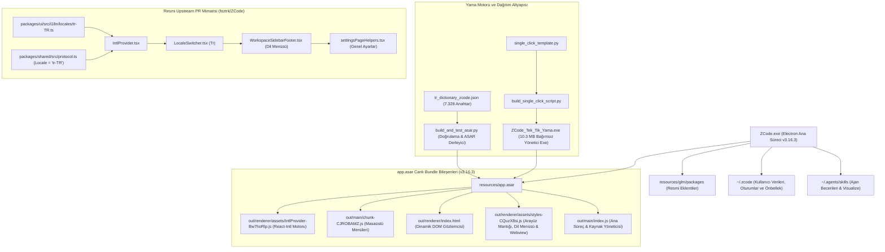

# 🧠 Codebase Memory & Bilgi Grafiği (Knowledge Graph) — ZCode Türkçe Yerelleştirme ve Kalıcı Yama Altyapısı

> **Son Güncelleme:** 2026-10-23  
> **Sürüm:** ZCode Desktop v3.16.3 (En Son Resmi Sürüm)  
> **Geliştirici:** Faruk Öztürk ([@foztrk](https://github.com/foztrk))  
> **Konum:** `C:\Users\Work-D\zcode-turkish-localization`  
> **Upstream Fork:** [foztrk/ZCode@feat/add-turkish-language-support](https://github.com/foztrk/ZCode/tree/feat/add-turkish-language-support)  
> **Durum:** Canlıda Aktif & %100 Doğrulanmış (7.328 Anahtar)

---

## 1. Mimarî Bilgi Grafiği (System Architecture Graph)

---

## 2. Dizinler, Düğümler ve Sorumluluklar

| Düğüm / Dosya | Rol ve İşlev | v3.16.3 Enjekte Edilen / Yamalanan Mantık |
| :--- | :--- | :--- |
| **`IntlProvider-Bw7hoRlp.js`** | React-Intl dil sağlayıcısı | `var _tr = { ... }; _ = { "zh-CN": m, "en-US": Object.assign({}, h, _tr) };` enjeksiyonu. 7.328 anahtar doğrudan belleğe yüklenir. |
| **`chunk-CJROBAMZ.js`** | Electron masaüstü menüleri | `J_["en-US"]` tablosuna Dosya, Düzen, Görünüm, Pencere, Yardım Türkçe menüleri eklenir. |
| **`index.html`** | Webview ve React kök belgesi | `DOM_MAP` içeren MutationObserver `<script>` bloğu. Dinamik parçalı React metinlerini ve buton etiketlerini anında Türkçeleştirir. |
| **`styles-CQuzX8si.js`** | Arayüz bileşenleri, stiller ve menüler | 1. **Dil Açılır Menüsü Entegrasyonu:** Sol alttaki profil menüsüne (`WorkspaceSidebarFooter`) ve Genel Ayarlar sayfasına `tr-TR` ("Türkçe") seçeneği doğrudan JSX seviyesinde dinamik regex ile enjekte edilir. 2. **Plan & Fiyatlandırma Webview:** Dinamik DOM gözlemcisi ile Bireysel ve Ekip planları Türkçeleştirilir. 3. **Yetenek ve Komut Açıklamaları:** `TR_SKILL_DESCS` ve `TR_CMD_DESCS` ile `visualize`, `docx`, `pdf`, `pptx`, `xlsx` becerileri dinamik çevrilir. 4. **Tarih & Sayı Biçimi:** `Intl.DateTimeFormat("tr-TR")` ve `NumberFormat("tr-TR")` aktif edilir. |
| **`out/main/index.js`** | Ana Electron süreci | Çince `\u8D44\u6E90\u7BA1\u7406\u5668` ve `资源管理器` metninin `Kaynak Yöneticisi` ile değiştirilmesi. |
| **`tr-TR.ts`** | Resmi monorepo dil dosyası | `zai-org/ZCode` ana deposuna yönelik hazırlanan 7.328 anahtarlık TypeScript dosyası. |
| **`ZCode_Tek_Tik_Yama.exe`** | Bağımsız dağıtım aracı | Gömülü Base64+Zlib sözlük, otomatik yönetici izni (UAC manifest), dinamik hash tarayıcı ve masaüstü kısayolu. |

---

## 3. Kritik Mühendislik Bulguları ve Çözülen Tuzaklar (Gotchas)

### 🚨 1. Zombi Electron Süreçleri ve LevelDB `LOCK` Kilitlenmesi
* **Sorun:** ZCode arka plandan (agent/terminal bağlamında) başlatıldığında, headless/servis oturumunda çalışır ve ekran açılmaz. Birden fazla çağrıda 16 adede kadar arka plan süreci asılı kalır. Bu süreçler `%APPDATA%\ZCode\session\Session Storage\LOCK` ve LevelDB kilitlerini tutar. Kullanıcı masaüstünden simgeye tıkladığında Electron `requestSingleInstanceLock` mekanizması nedeniyle pencere ekrana gelmez ("ZCode hiç açılmıyor" hatası).
* **Kalıcı Kural:** ZCode süreçleri güncellemelerden önce kesinlikle `taskkill /F /IM ZCode.exe` ile temizlenmeli, kilitler serbest bırakılmalı ve ZCode kullanıcının kendi masaüstü oturumunda (`explorer.exe` veya kullanıcı kısayolu) başlatılmalıdır.

### 🚨 2. Buton ve Segmentlerde Title Case Kuralı
* **Sorun:** Küçük harfli veya standart cümle yapısı ("Çalışan bir konteyner seçin", "Özel key") kullanıcı arayüzü yönergelerine aykırıdır.
* **Kalıcı Kural:** Buton, sekme ve segmentli seçim etiketlerinde her kelimenin ilk harfi büyük olmalıdır: **`"Çalışan Bir Konteyner Seçin"`**, **`"Özel Anahtar"`**, **`"Kaynak İndirme Yöntemi"`**.

### 🚨 3. Kelime Sırası ve Ters Çeviri Tuzakları
* **Sorun:** İngilizce "Copy Markdown" ve "Preview table" ifadelerinin "Kopyala Markdown" ve "Önizle table" olarak kalması.
* **Kalıcı Kural:** Türkçe dilbilgisi nesne-yüklem yapısına uygun olmalıdır: **`"Markdown'ı Kopyala"`**, **`"Tabloyu Önizle"`**.

### 🚨 4. Geliştirici İsmi Hassasiyeti
* **Kalıcı Kural:** Kullanıcının adı **Faruk Öztürk**'tür (`foztrk`). Resmi yazışmalarda, commit imzalarında ve PR metinlerinde kesinlikle Faruk Öztürk adı kullanılır.

### 🚨 5. Minified Tanımlayıcılarda Dolar İşareti (`$`) ve Dinamik Regex
* **Sorun:** JS bundler değişken veya fonksiyon adlarında `$` kullanabilir (örneğin `$D`). Standart `\w+` regex'i dolar işaretini eşleştirmediğinden yama sessizce atlanabilir veya UnboundLocalError verebilir.
* **Kalıcı Kural:** JS tanımlayıcıları için `[\w$]+` kullanılmalı ve minified kod değişimlerine karşı dinamik regex kalıpları tercih edilmelidir.

---

## 4. Upstream Katkı ve Resmi GitHub Durumu

- **Hedef Organizasyon:** `zai-org` (Zhipu AI)
- **Ana Depo:** `zai-org/ZCode`
- **Fork Deposu:** `foztrk/ZCode`
- **Geliştirme Dalı:** `feat/add-turkish-language-support`
- **Resmi Issue:** [zai-org/feedback#1047](https://github.com/zai-org/feedback/issues/1047#issuecomment-6291121632)
- **Durum:** `zai-org/ZCode` dış PR alımına yetki kısıtı uyguladığı için tüm merge komutları ve dal bağlantısı Issue #1047 üzerinden geliştirici ekibine teslim edilmiş, Z.ai Destek ekibine e-posta ile bildirilmiştir.
